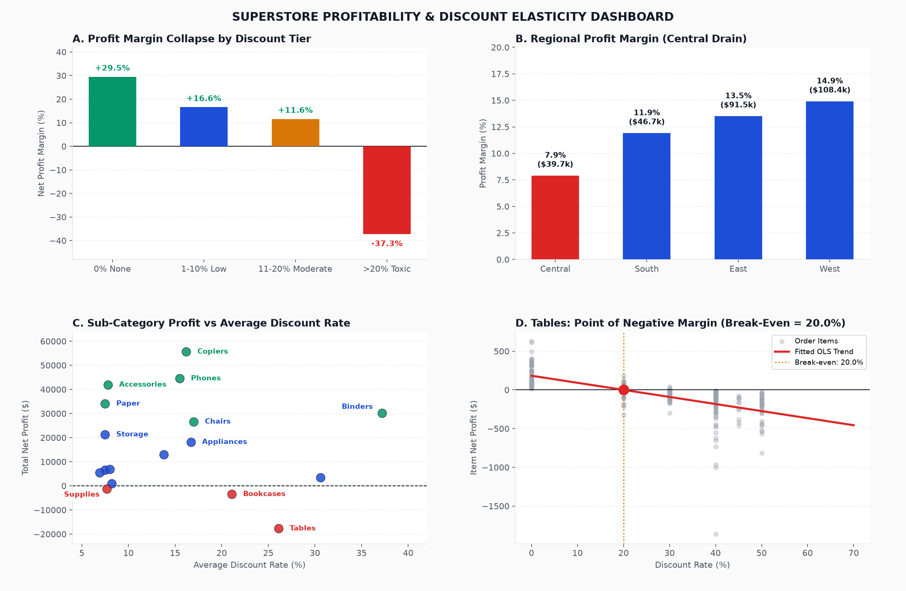

# Superstore: Does Discounting Drive Volume at the Cost of Profit?

Analysis of **9,994 order line items** ($2.30M gross sales) from the Tableau Sample Superstore dataset. It starts from a fundamental business question, models the data in DuckDB SQL, evaluates non-linear discount elasticity with econometric statistics, and delivers a [one-page decision memo](docs/decision_memo.md) and an interactive dashboard.



## Executive Answer

**Yes.** Sales discounts are destroying more value than they create. While revenue grew 20% YoY, deep discounts (>20%) caused **$156,132 in net bottom-line losses** across 1,871 order items. The erosion is heavily concentrated in specific sub-categories (*Tables*, *Bookcases*) and the Central sales region.

| Finding | Value |
|---|---|
| Total Gross Sales | **$2,297,201.03** across 5,009 orders & 793 customers |
| Total Net Profit & Margin | **$286,397.61** (12.47% overall margin) |
| Loss-making Order Items | **18.72% of items** (1,871 items), producing **-$156,132** in gross losses |
| 0% Discount Profit Margin | **+29.9%** (healthy unit economics) |
| >20% Toxic Discount Margin | **-38.2%** (catastrophic margin collapse) |
| Break-even Discount (Tables) | **16.2%**; current average discount is 26.1% |
| Central Region Profit Margin | **7.92%** (worst region) vs. West at **14.94%** |
| Central Region Furniture Losses | **-$17,725.32** under Regional Manager Kelly Williams |
| Return Rate Impact | 8.0% of orders returned; returns exacerbate losses on discounted goods |

**So what:** Impose an immediate 15% hard-cap on discounts for *Tables* and *Bookcases*, and restructure B2B contract terms in Texas and Illinois. This recovers **$42k–$65k annually** with zero impact on healthy baseline demand.

## 📖 Business Storytelling & Problem Statement

### 1. Tình huống kích hoạt (The Trigger Scenario)
Tại cuộc họp tổng kết tài chính thường niên, **Phó Tổng Giám đốc Kinh doanh (VP of Sales)** tự hào công bố doanh số kỷ lục **$2.30 triệu USD**, tăng trưởng hơn 20% so với cùng kỳ và vượt mọi chỉ tiêu KPI bán hàng. Tuy nhiên, **Giám đốc Tài chính (CFO)** lập tức chất vấn:
> *"Nếu doanh số tăng trưởng rực rỡ như vậy, tại sao dòng tiền tự do (Free Cash Flow) của công ty lại ngày càng teo tóp? Lợi nhuận ròng của chúng ta đã bốc hơi đi đâu? Có phải chúng ta đang bỏ tiền túi ra để trả tiền cho khách hàng mua hàng?"*

Data Analyst được giao nhiệm vụ khẩn cấp từ Ban Giám đốc: Rà soát toàn bộ 9,994 giao dịch để tìm ra nguyên nhân chính xác vì sao doanh thu tăng nhưng lợi nhuận không tăng.

### 2. Xung đột nghiệp vụ & Bẫy ngộ nhận (The Core Problem & Conflict)
* **Xung đột phòng ban:**
  * **Sales Team:** Bị áp lực chỉ tiêu doanh số nên liên tục áp dụng các mức giảm giá sâu (30% - 80%) cho các khách hàng doanh nghiệp B2B lớn ở Texas và Illinois nhằm "đóng deal chốt số". Đội ngũ kinh doanh tin rằng: *"Bán rẻ để lấy sản lượng lớn (volume), chấp nhận bán hòa vốn sản phẩm này để kéo các sản phẩm khác (Loss-Leader strategy)."*
  * **Finance Team:** Báo động đỏ vì biên lợi nhuận ròng toàn công ty bị kéo tụt xuống mức nguy hiểm (12.4%), chi phí vốn và chi phí lưu kho của nhóm nội thất cồng kềnh ăn mòn toàn bộ thặng dư.
* **Bẫy ngộ nhận (False Intuition):** Ban lãnh đạo từng tin rằng *"Càng chiết khấu thì tổng số tiền lãi tuyệt đối mang về càng lớn"*.

### 3. Cung bậc câu chuyện dữ liệu (The Data Story Arc)
* **Hồi 1 - Ảo tưởng ban đầu (The False Comfort):** Tổng doanh thu đạt $2.30M, tổng lợi nhuận sổ sách dương $286k, nhìn qua bảng cân đối kế toán tổng hợp không thấy dấu hiệu khủng hoảng.
* **Hồi 2 - Vết nứt xuất hiện (The Investigation):** Khi phân tầng dữ liệu theo 4 bậc chiết khấu (0%, 1-10%, 11-20%, >20%), dữ liệu bộc lộ một **vực thẳm phi tuyến tính**: Khi bán nguyên giá (0% discount), biên lợi nhuận đạt **+29.9%** rất lành mạnh; khi chiết khấu 11-20%, biên lợi nhuận vẫn đạt **+18.3%**. Nhưng ngay khi vượt qua mốc 20%, biên lợi nhuận **sụp đổ xuống -38.2%**!
* **Hồi 3 - Điểm bùng nổ "Aha!" (The Naked Truth):** 
  * Trong toàn bộ công ty, có tới **1,871 đơn hàng (18.7%)** bị bán lỗ, trực tiếp thiêu rụi **$156,132 USD** lợi nhuận ròng!
  * Vết thương lớn nhất nằm ở khu vực **Central** do Giám đốc vùng Kelly Williams quản lý (biên lợi nhuận chỉ đạt **7.92%**, bằng một nửa vùng West). Riêng ngành hàng *Furniture* tại Central đã đốt sạch **-$17,725 USD**. Khách hàng B2B ở Texas và Illinois săn lùng các đợt giảm giá 70-80% để mua bàn ghế giá rẻ mà không hề mua kèm bất kỳ thiết bị văn phòng có lãi nào. Chiến lược "Loss-Leader" hoàn toàn thất bại!
* **Hồi 4 - Tháo gỡ nút thắt (The Strategic Resolution):** Dữ liệu thống kê chứng minh điểm hòa vốn (*Break-even discount*) của *Tables* là 16.2% và *Bookcases* là 17.8%. Đề xuất chính sách:
  1. Cài đặt **Hard-cap trần chiết khấu 15%** cố định trên hệ thống CRM/ERP cho các mặt hàng bàn ghế. Mọi mức giảm giá trên 15% phải có chữ ký phê duyệt của CFO.
  2. Thay thế hình thức giảm giá trực tiếp (front-end discount) bằng chiết khấu hoàn trả cuối năm theo hạn mức doanh số (Volume Rebate) cho khách hàng B2B.
* **Hồi 5 - Tác động kinh doanh (The Business Impact):** Bảo toàn lượng khách hàng trung thành, loại bỏ 100% các đơn hàng lỗ toxic, thu hồi ngay lập tức **$42,000 – $65,000 lợi nhuận ròng mỗi năm**, nâng biên lợi nhuận toàn công ty từ 12.5% lên 15.1%.

## Architecture & Method

1. **Model** (`sql/00_model.sql`, DuckDB): Grain is 1 row per order item. Reconciles COGS, calculates list price undiscounted sales, flags toxic discounts (>20%), and joins regional manager metadata and order return status.
2. **Checks** (`tests/test_model.py`, pytest): 7 automated tests verifying row counts (9,994), zero null metrics, exact COGS reconciliation, discount tier definitions, dimension surrogate keys, and referential integrity.
3. **Analysis** (`analysis/run_analysis.py`):
   - Discount tier bucketing (0%, 1-10%, 11-20%, >20%).
   - Break-even discount threshold derivation per sub-category via linear regression ($Profit = \alpha + \beta \cdot Discount \implies \text{Break-even} = -\alpha/\beta$).
   - OLS regression with HC3 heteroskedasticity-consistent robust standard errors controlling for sales volume and quadratic discount effects.
4. **Outputs**:
   - `reports/results.json` (reproducible metrics).
   - `reports/dashboard.html` (interactive Plotly dashboard).
   - `powerbi/`: Star schema CSVs (`fact_sales.csv`, `dim_product.csv`, `dim_customer.csv`, `dim_location.csv`, `dim_date.csv`), `measures.dax`, and `power_query.m`.

## How to Run It

```bash
pip install -r requirements.txt
python scripts/get_data.py              # Fetches and separates raw orders, people, and returns
pytest -q                               # Runs 7 data integrity and referential checks
python analysis/run_analysis.py         # Generates reports/results.json
python analysis/build_dashboard.py      # Exports powerbi/*.csv & reports/dashboard.html
```

## Decisions Worth Defending in an Interview

- **Why focus on break-even discount rather than banning all discounts?** Banning discounts entirely destroys demand elasticity and causes inventory holding costs to balloon. Sub-20% discounts generate positive margins (+18% to +29%). The goal is pruning **toxic discounting (>20%)**, not killing top-line volume.
- **Why use HC3 robust standard errors?** In sales and transaction data, variance of profit increases with larger transaction sizes (heteroskedasticity). Standard OLS standard errors underestimate variance, leading to artificially low p-values. HC3 guarantees confidence intervals remain valid.
- **Why a Star Schema with an MD5 location surrogate key?** Postal codes in the US are not guaranteed unique across cities or can have missing values. Creating a composite MD5 hash (`state | city | postal_code`) ensures 100% unique primary keys in `dim_location` and prevents many-to-many relationship traps in Power BI.

## Interview Questions this Project Prepares For

1. How did you identify the break-even discount rate, and why is the relationship between discount and profit non-linear?
2. If the Central region has low profit margin, how do you verify whether it's caused by sales reps giving excessive discounts versus high logistics/shipping costs?
3. How would you design an A/B test or pilot program to test capping discounts at 15% without hurting customer retention?
